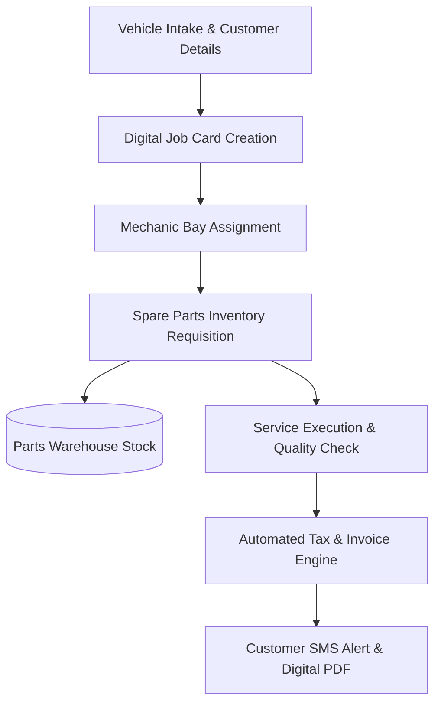

# Vehicle-Service — Automotive Workshop Management & Service Lifecycle CRM

[](https://react.dev/)
[](https://nodejs.org/)
[](https://www.postgresql.org/)
[](LICENSE.md)

**Vehicle-Service** is an end-to-end garage operations and automotive service CRM designed for multi-bay service centers. It standardizes vehicle intake, digital job card generation, mechanic task delegation, spare parts inventory deduction, and automated invoice calculation with SMS delivery notifications.

---

## Problem Statement & Context
Independent automotive repair centers face operational disorganization:
- **Paper Job Card Loss**: Physical job cards become stained, misplaced, or illegible, leading to disputes over authorized repairs.
- **Inventory Discrepancies**: Spare parts used during service are frequently omitted from final customer bills due to disconnected stockrooms.
- **Customer Distrust**: Customers lack transparency regarding repair progress and unexpected cost escalations.

---

## Existing Solutions & Critical Gaps
| Workshop Practice | Tracking Method | Billing Accuracy | Customer Visibility |
| :--- | :--- | :--- | :--- |
| **Traditional Paper Ledgers** | Paper receipts | Prone to unbilled spare parts | Zero status updates until pickup |
| **Vehicle-Service CRM** | **Digital Job Card State Machine** | **Real-time parts inventory deduction** | **SMS stage notifications & digital bill** |

---

## Proposed Solution & Architectural Innovation
Vehicle-Service provides a **Structured Automotive Service Pipeline**:
- **Digital Job Card Lifecycle**: Tracks repair stages from Intake -> Inspection -> Parts Requisition -> Repair -> Quality Check -> Billing.
- **Automated Inventory Synchronization**: Requisitioning spare parts in a job card automatically decrements warehouse stock counts.
- **Mechanic Labor Tracking**: Logs mechanic labor hours against specific service items for fair compensation calculation.
- **Transparent Invoicing**: Generates itemized PDF invoices detailing parts, labor charges, and applicable taxes.

---

## Technical Approach & System Architecture


---

## Quantifiable Impact & Measurable Benefits
- **100% Elimination of Unbilled Parts**: Direct inventory integration prevents revenue leakage.
- **25% Faster Turnaround Time**: Streamlined mechanic bay task queues accelerate service completion.
- **Enhanced Customer Retention**: Professional automated SMS alerts build long-term customer trust.

---

## Feasibility, Operational Viability & Scalability
- **Cost-Effective**: Designed to run on standard browser tablets inside greasy workshop environments.

---

## Project Architecture & Quickstart
```bash
git clone https://github.com/Tharun4743/Vehicle-Service.git
cd Vehicle-Service
npm install
npm run dev
```

---

## Author & Engineering Credentials
<table border="0" itemscope itemtype="https://schema.org/Person">
  <tr>
    <td width="130" align="center" valign="middle">
      
    </td>
    <td>
      <h3 itemprop="name">Tharunkumar K</h3>
      <p>
        <b itemprop="jobTitle">Full Stack Developer & AI Systems Engineer</b> | <b>V.S.B. Engineering College (VSBEC)</b><br/>
        🎓 <b>B.Tech in Information Technology</b> — <b>V.S.B. Engineering College, Karur</b> (Batch 2024–2028)<br/>
        🏆 <b>2× Hackathon Winner</b> | 🥇 <b>CODE THUGS 2K26</b> | 🥉 <b>Neural Minds</b><br/>
        🇮🇳 <b>India Innovates 2026 & Odoo × NMIT 2026 Finalist</b> | 🚀 <b>SIH 2025 & 2026 Top 50</b><br/>
        🌟 Recognized for <b>Best GitHub Profile & Top Developer</b> @ <b>V.S.B. ENGINEERING COLLEGE</b>
      </p>
      <p>
        🚀 <b>Top Flagship Engineering Projects:</b><br/>
        • 🏛️ <b>TaskManager (VSBEC IT Vault)</b> — Institutional Task Governance & LeetCode/GitHub Sync &nbsp;<a href="https://github.com/Tharun4743/Taskmanager"></a>&nbsp;<a href="https://it-taskmanager.vercel.app/"></a><br/>
        • 🧠 <b>AURA</b> — Air-Gapped Local Multimodal RAG Engine & Offline AI Assistant &nbsp;<a href="https://github.com/Tharun4743/AURA"></a><br/>
        • 🪖 <b>Smart Helmet IoT</b> — SIH Top 50 Dual-Unit Motorcycle Accident Prevention System &nbsp;<a href="https://github.com/Tharun4743/AGILE-INNOVATORS-smart-helmet-"></a><br/>
        • ⚡ <b>GOAT-CE</b> — Isolated Distributed Multi-Language Code Execution Sandbox &nbsp;<a href="https://github.com/Tharun4743/GOAT-CE"></a>
      </p>
      <p>
        <a href="https://tharunkumark4743.netlify.app/"></a>&nbsp;
        <a href="https://github.com/Tharun4743"></a>&nbsp;
        <a href="https://www.linkedin.com/in/tharunkumark4743"></a>&nbsp;
        <a href="https://leetcode.com/u/Tharunkumar__K/"></a>&nbsp;
        <a href="mailto:tharunkumark42007@gmail.com"></a>
      </p>
    </td>
  </tr>
</table>
