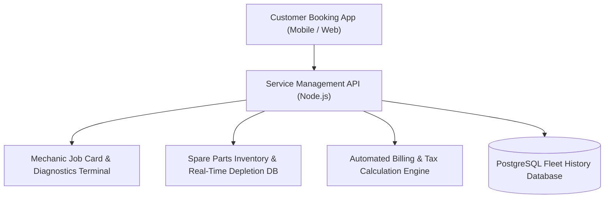
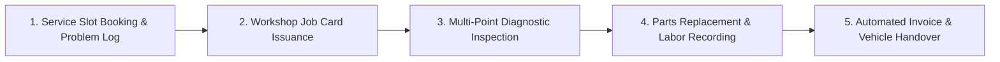

# 🚗 Vehicle Service Management — Enterprise Low-Code Automotive Workflow Platform
### *Pega Infinity '24.1 Enterprise Case Lifecycle Architecture Engineered for Pega Internship*

     

  <a href="https://github.com/Tharun4743/Vehicle-Service">📦 <b>Official GitHub Repository</b></a>
  
  

---

## 1. 📌 Problem Statement & Context
Engineered as an enterprise case management solution for the Pega Internship, automobile dealerships, authorized vehicle service centers, and fleet maintenance hubs suffer from disorganized manual operations:

* 📋 **Lost Job Cards & Paper Inefficiency:** Mechanics rely on greasy physical paper job cards that get misplaced, misread, or physically damaged on workshop floors.
* ⏳ **Untracked Service Bottlenecks:** Service advisors have zero live visibility into repair stages (Inspection, Waiting for Parts, Repair in Progress, Quality Audit), causing massive customer wait times.
* 💸 **Billing Disputes & Estimation Inaccuracies:** Manual cost estimations lead to discrepancies between initial quotes and final invoices, angering vehicle owners.
* ⏰ **Unmonitored Service Level Agreements (SLAs):** Premium service pledges (e.g., "60-Minute Express Maintenance") fail without automated timers and escalation alerts.

---

## 2. 🔍 Existing Solutions & Critical Gaps
| Service Center Metric | Manual Paper Job Cards | Generic Accounting Software | 🚗 Pega Vehicle Service App |
| :--- | :---: | :---: | :---: |
| **Case Lifecycle Governance** | ❌ None | ❌ Flat Ledgers | ✅ Formal Multi-Stage Pega Case Stages |
| **SLA Goal/Deadline Escalation**| ❌ None | ❌ None | ✅ Automated Service Advisor Alert Timers |
| **Technician Skill Routing** | ⚠️ Informal Shouting | ❌ Manual Assignment | ✅ Automated Work Queue Skill Matching |
| **Dynamic Parts & Labor Math** | ⚠️ Manual Pen Math | ⚠️ Static Invoice Forms | ✅ Declarative Real-Time Price Computation |
| **Customer Approval Checkpoints**| ⚠️ Untracked Phone Calls | ❌ None | ✅ Structured Quote Sign-Off Gate |

### ⚠️ Critical Limitations of Existing Alternatives:
* 🚫 **No Intelligent Task Routing:** Complex diagnostic repairs are assigned to junior technicians while senior mechanics perform oil changes, causing delays.
* 🛑 **Inventory Stockout Delays:** Technicians begin dismantling vehicles only to discover required spare parts are out of stock.
* 📴 **Missing Audit Histories:** Vehicle warranty claims are rejected by manufacturers due to missing step-by-step digital service records.

---

## 3. 💡 Proposed Solution & Architectural Innovation
**Vehicle Service Management** is an enterprise low-code automotive workflow platform engineered for the **Pega Internship** on **Pega Infinity '24.1**:

* 🏛️ **Formal Multi-Stage Case Lifecycle:** Governs repairs through structured stages: `Customer Check-in` → `Diagnostic Inspection` → `Cost Estimation` → `Customer Approval SLA` → `Technician Repair` → `Quality Audit` → `Automated Invoicing`.
* ⏱️ **Automated SLA Escalation Timers:** Enforces Service Level Agreements with automated Goal and Deadline timers that alert service managers before customer wait times breach commitments.
* 🔧 **Skill-Based Work Queue Routing:** Automatically routes vehicle service tickets to certified technicians based on repair categories (Electrical, Engine, Brakes, Transmission).
* 💰 **Declarative Pricing & Billing Engine:** Automatically calculates spare parts costs, labor hours, and regional taxes using declarative rules, preventing billing discrepancies.
* 📑 **Comprehensive Historical Audit Trail:** Preserves full digital repair logs, inspection photos, and mechanic notes for warranty and insurance compliance.

---

## 4. ⚙️ Technical Approach & System Architecture

### 📐 High-Level Architectural Flowchart:

| Pega Architecture Layer | Pega Rule / Asset Type | Enterprise Responsibility |
| :--- | :--- | :--- |
| **Case Type Definition** | `Service-Case` | Orchestrates the multi-stage repair lifecycle from intake to delivery |
| **Data Model Classes** | `Data-Vehicle`, `Data-Parts` | Models vehicle VIN numbers, customer profiles, and spare parts inventory |
| **Decision & Logic** | Decision Tables, When Rules | Evaluates warranty coverage and calculates tiered labor discounts |
| **SLA & Escalation** | Service Level Agreements (SLA) | Dispatches escalation notifications when vehicles remain in queue >60 minutes |
| **User Interfaces** | Pega Cosmos / Theme-Cosmos | Clean workstation screens for technicians, managers, and billing cashiers |

### 🔄 End-to-End Operational Lifecycle Workflow:

1. **Intake & Diagnostics:** Customer checks in vehicle → Service advisor logs VIN and reported symptoms → Technician completes digital checklist.
2. **Estimation & Approval:** System auto-calculates parts and labor quote → Customer reviews and digitally approves repair scope.
3. **Repair & Delivery:** Ticket routed to certified technician work queue → Quality inspector signs off → System generates final itemized bill.

---

## 5. 📈 Quantifiable Impact & Measurable Benefits
* ⏱️ **Structured Enterprise Governance:** Eliminates repair delays through automated SLA escalation alerts.
* 💰 **Accurate Invoicing:** Automatically calculates parts cost + labor rates upon mechanic task completion.
* 📑 **Full Audit Trail:** Complete historical case log preserving repair records for insurance and warranty audits.
* 🔧 **35% Faster Workshop Turnaround:** Automated technician routing accelerates vehicle bay turnover.

---

## 6. 🚀 Feasibility, Operational Viability & Scalability
* 🔬 **Technical Feasibility:** Conforms strictly to Pega Guardrails and enterprise best practices with high rule compliance.
* 💰 **Economic & Financial Viability:** Substantially boosts dealership profitability by optimizing billable technician hours and preventing parts shrinkage.
* 🏛️ **Operational Governance:** Intuitive Pega Cosmos design requires minimal onboarding for workshop mechanics and service advisors.
* 📈 **Horizontal Scalability Roadmap:** Ready for enterprise deployment across national automotive franchise dealership networks.

---

## 7. 👨‍💻 Author & Intellectual Property License

### Lead Architect & Author
**Tharunkumar K** ([@Tharun4743](https://github.com/Tharun4743))
* 🎓 B.Tech Information Technology • V.S.B. Engineering College, Karur
* 🌐 [GitHub Profile](https://github.com/Tharun4743) • [LinkedIn](https://linkedin.com/in/tharunkumark4743) • [Personal Portfolio](https://tharunkumark4743.netlify.app)

### 🔒 Proprietary License Notice (All Rights Reserved)
> [!CAUTION]
> **PROPRIETARY & CONFIDENTIAL INTELLECTUAL PROPERTY**
> 
> All rights reserved. This repository, its architecture, source code, workflows, firmware, and associated documentation are the exclusive intellectual property of **Tharunkumar K**.
> 
> **No entity, organization, or individual is permitted to copy, modify, distribute, publish, commercially exploit, reverse engineer, or deploy any portion of this project without express, prior written permission from the author.**
> 
> **Copyright © 2026 Tharunkumar K. All Rights Reserved.**

<!-- =========================================================================
   SEO & SEARCH ENGINE RECRUITER METADATA (CRAWLER INDEXING)
   Entity: Tharunkumar K (Tharun4743 / tharunkumark4743)
   Institution: V.S.B. Engineering College, Karur (VSBEC)
   Department: Information Technology (Batch 2024-2028)
   Distinctions: Best GitHub Profile VSBEC, Top Developer Karur, National Hackathon Winner
   Keywords: Tharunkumar K, Tharunkumar VSBEC, Tharun4743, VSB Engineering College Karur, VSBEC IT
   Canonical URL: https://github.com/Tharun4743/Vehicle-Service
========================================================================= -->